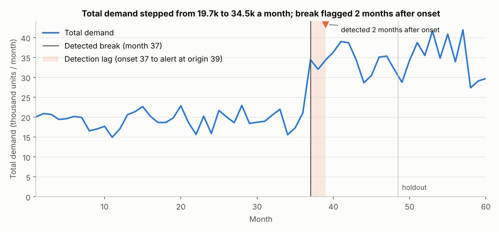
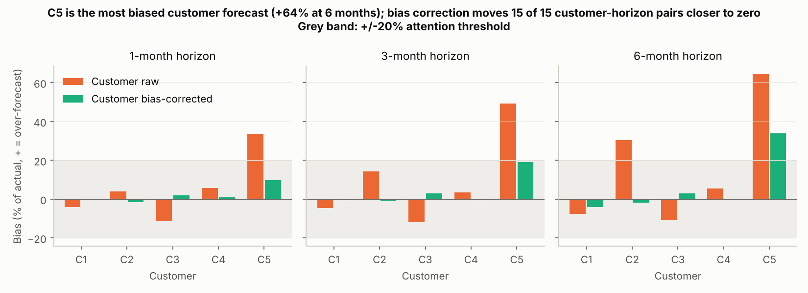
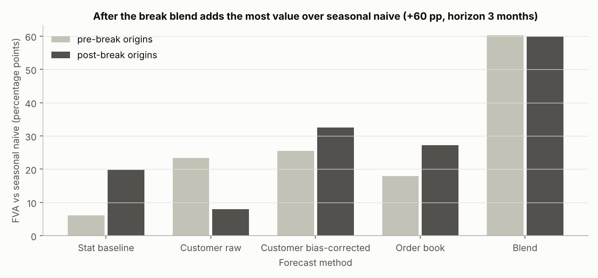
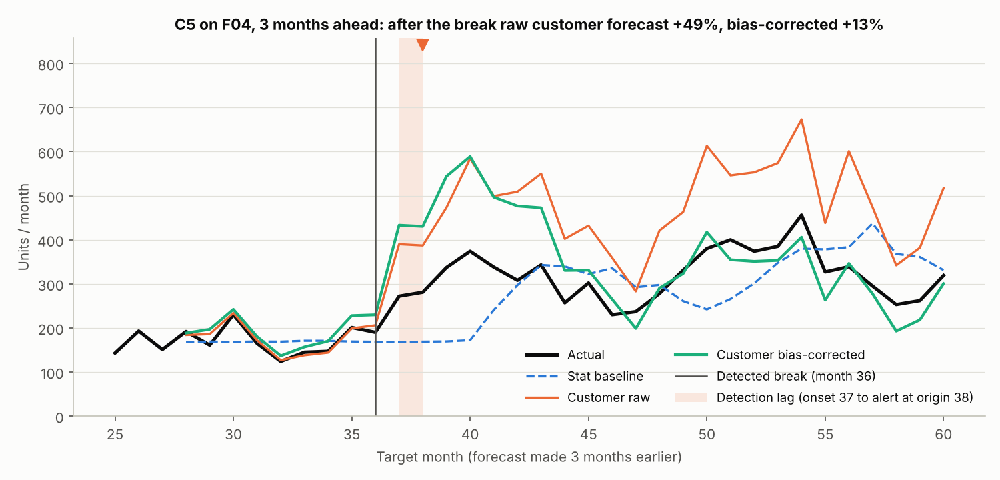
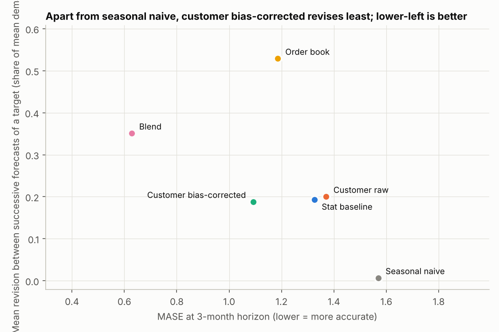

# Forecast governance for a component supplier

All data in this repo is synthetic and generated by code in the repo. No real company, customer, product or figure appears. The repo is a small reference implementation of a forecast governance layer for demand planning.

The setting is a supplier of components to capital-equipment OEMs, with five large customers, twelve product families and long lead times. Customers send rolling forecasts that are biased in known ways: one over-forecasts, one under-forecasts, one is noisy, and one panics when the market turns. Four families are lumpy and intermittent, two are new with little history, and at month 37 demand steps up sharply in an industry upcycle, so any model that relies on history goes wrong for a while.

The aim is not a better model. The aim is to show what every forecast should report before a planner acts on it: bias, value added, stability, interval coverage, and whether history can still be trusted.

## Headline findings

These numbers come from `outputs/governance_report.md`, default seed.

- C5's own forecast is the least trustworthy: +64% bias at 6 months, and still +34% after bias correction.
- Total demand stepped from 19,651 to 33,940 units a month. The alert fired at origin 39, 2 months after the onset at month 37.
- After the break the blend adds +60 pp over seasonal naive at 3 months, but a third of that is routing: intermittent families go to the order book, which still sees most lumpy orders three months out. Without the order book the blend adds +40 pp (`scripts/blend_probe.py`). On smooth families, averaging the three sources adds +56 pp against +43 pp for the best single source.
- The stat baseline's 80% interval covered the actual only 50% of the time before the break and 59% after, against 72% and 76% for the blend. Intervals built on stale history are too narrow once the level has moved.

Across 20 seeds (`scripts/seed_study.py`) the picture holds: C5's raw bias after the break is +49% to +80% and falls to 0% to +21% after correction, the total break is flagged 1 to 4 months after onset, and the blend adds 55 to 68 pp over seasonal naive at 3 months. Per-family detection within four months ranges from 4 to 8 of the 10 established families, so the spec's 10 of 12 is not met on any seed. The ranges are in `scripts/seed_study_20seeds.csv` and `NOTES.md`.

## Charts

The five charts below are the committed output of the default run. The full report is [outputs/governance_report.md](outputs/governance_report.md) and the planner table is [outputs/planner_table.csv](outputs/planner_table.csv).











## How to read the planner table

`recommended_source` is the forecast source that won on trailing value added for that family at the planning origin, so it is the number a planner starts from; `average` means the simple average of the stat baseline, the bias-corrected customer forecast and the order book, which is what the blend reports under its own name in the metrics. `history_unreliable` is true once a break has been detected for the family, or while a new family has under 12 months of history, and means the history-based sources (seasonal naive and the stat baseline) should not be trusted for that row. `attention_flag` is true when the customer's trailing bias is beyond 20%, when the recommended source changed since the previous origin, or when a break was detected at this origin, and `attention_reason` says which. In the default seed every flagged row belongs to C5 because its trailing bias at the planning origin is +54%, and that is the only trigger that fires there.

## How to run

```bash
pip install -e ".[dev]"
```

```bash
python -m fgov.run
```

The run regenerates everything in `outputs/` from a fixed seed. It takes about 45 s on an idle 4-core machine and two to four times that under load, almost all of it in the backtest of candidate forecasts. For a quick partial run use a later first origin, for example `--origins-from 45`; with no pre-break origins the pre-break figures in the report read n/a. Tests run with `python -m pytest -q`. The quality gate is `ruff check .` plus `pyright src`, and both must be clean before a commit; the `dev` extra installs pytest, ruff, pyright and the pandas type stubs pyright needs.

## Outputs

| File | What it means for a planner |
|---|---|
| `outputs/actuals.parquet` | True monthly demand per customer and family, months 1 to 60 (48 of history, 12 of holdout). New families are empty before launch, not zero. |
| `outputs/customer_forecasts.csv` | What each customer said a month would be, at 1, 3 and 6 months before it. |
| `outputs/order_book.csv` | Orders already confirmed for each of the next 1 to 6 months, as of each month. |
| `outputs/families.csv` | Which families are intermittent, new or long-lead, and how much each one stepped up. |
| `outputs/summary_metrics.csv` | For each method, horizon and pre/post-break period: MASE, signed bias, 80% interval coverage, and value added versus seasonal naive and versus the stat baseline. |
| `outputs/planner_table.csv` | One row per customer and family for the next planning month: recommended source, forecast, 80% interval, trailing customer bias, history-unreliable flag, and attention flag with reason. Flagged rows come first. |
| `outputs/governance_report.md` | The one-page report for a planner and their manager. Each section opens with its finding. |
| `outputs/charts/total_demand_and_break.png` | Total demand, with the detected break and the detection lag marked. |
| `outputs/charts/customer_bias_by_horizon.png` | Each customer's bias at 1, 3 and 6 months, raw and bias-corrected, against a 20% threshold. |
| `outputs/charts/fva_by_method.png` | Value added over seasonal naive at 3 months, by method, before and after the break. |
| `outputs/charts/tracking_c5.png` | C5 on family F04 through the step: actual, stat baseline, raw and corrected customer forecast. |
| `outputs/charts/stability_vs_accuracy.png` | Each method's accuracy (MASE) plotted against how much it revises between origins. |

`outputs/seed_study.csv` is not written by the run. It comes from `scripts/seed_study.py`, which reruns the pipeline over other seeds to check robustness.

## What this is not

- No deep learning, no foundation models, no hyperparameter search.
- No web app and no dashboard framework. The outputs are static PNG charts and one markdown report.
- No database and no cloud deployment.
- No more than about 1,500 lines of Python. There are currently about 1,260 in `src/fgov` (`wc -l`).

## Where it would live

[docs/architecture.md](docs/architecture.md) covers how this layer would sit in a production planning stack. [docs/governance_standard.md](docs/governance_standard.md) covers what a forecast must report before a planner sees it. Both are the owner's own documents, written by hand; at the moment both files are placeholders.

## Repository layout

```
README.md
SPEC.md                  build spec
NOTES.md                 judgement calls and open questions
pyproject.toml           dependencies, ruff and pytest config
src/fgov/
  synth.py               synthetic panel generator, all parameters in one dataclass
  forecast.py            six candidate forecasts, rolling-origin backtest
  metrics.py             MASE, bias, FVA, stability, coverage
  breaks.py              change-point detection and alert table
  report.py              planner table, charts, governance report
  run.py                 end to end: generate, detect, forecast, report
tests/
  test_synth.py  test_forecast.py  test_metrics.py  test_breaks.py  test_report.py
scripts/
  seed_study.py          rerun the pipeline across seeds
  blend_probe.py         error correlations, leakage check, blend without the order book
docs/
  architecture.md        placeholder, owner-written
  governance_standard.md placeholder, owner-written
outputs/                 generated; the report, its two tables and the charts are committed, the data files are not
```

`NOTES.md` lists the judgement calls and the known deviations from the spec. The main one concerns break detection. The spec expected the step to be caught within four months in 10 of 12 families. On the default seed it is caught in 9 of 12. F08 steps only 1.3x under lumpy demand and is never detected. This is reported as found; the detector was not tuned to hide it.
