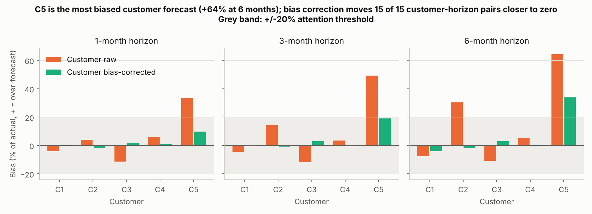
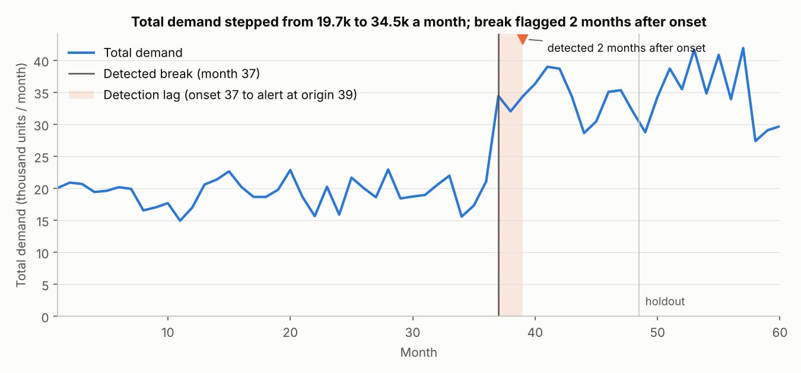
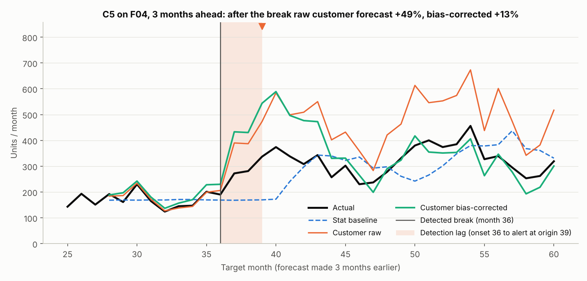
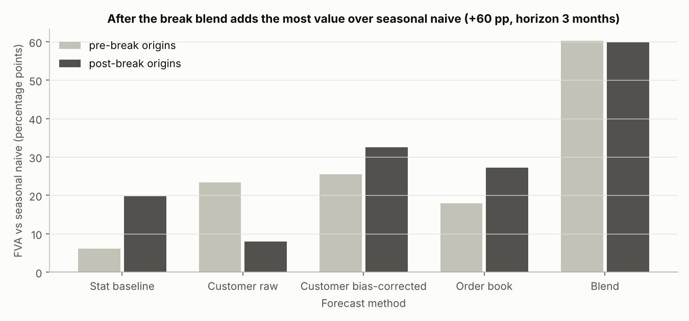
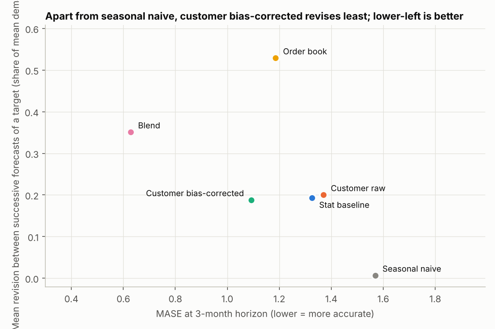

# Forecast governance report

## 1. What this is

All data in this report is synthetic, generated by code in this repository with a fixed seed; no real company, customer or product appears. It evaluates 6 forecast sources for 5 customers and 12 product families on rolling origins, and reports bias, value added, stability and a break alert for each. It ends with a planner table for target month 60.

## 2. Which customer forecasts to trust

C5's own forecast is the least trustworthy (+64% bias at 6 months, +34% after bias correction); C1, C4 stay within 10% at every horizon. Bias correction moves 15 of 15 customer-horizon pairs closer to zero.

Bias in percent of actual demand (positive = customer over-forecasts), all origins pooled:

| customer | raw h1 | raw h3 | raw h6 | corrected h1 | corrected h3 | corrected h6 |
|---|---|---|---|---|---|---|
| C1 | -4.0 | -4.7 | -7.6 | +0.2 | -0.6 | -4.0 |
| C2 | +4.1 | +14.3 | +30.5 | -1.6 | -0.7 | -1.7 |
| C3 | -11.4 | -11.8 | -10.8 | +2.1 | +2.9 | +3.1 |
| C4 | +5.8 | +3.6 | +5.5 | +0.9 | -0.4 | +0.3 |
| C5 | +33.7 | +49.3 | +64.4 | +9.9 | +19.2 | +33.9 |

## 3. What happened at the break

Total demand stepped from 19,651 to 34,477 units a month and the alert fired at origin 39, 2 months after the onset at month 37.

For C5 on F04 (the long-lead family with the largest step, 1.83x), the raw customer forecast ran +49% against actuals after the break at 3 months ahead, the bias-corrected forecast +13% and the stat baseline -6%.

The stat baseline's 80% interval covered the actual 50% of the time at pre-break origins and 59% after, against 72% and 76% for the blend. Intervals built on stale history are too narrow once the level has moved, so a planner reading them as 80% bands would be surprised far more often than one time in five. Pre-break figures are grouped by forecast origin, so forecasts made in the months just before month 37 for targets inside the step count as pre-break; part of the pre-break shortfall is that, and part is the two-window conformal calibration, which under-covers everywhere.

Families never detected: F08.

| family | detected_at_origin | months_after_onset | pre_break_level | post_break_level | reason |
|---|---|---|---|---|---|
| TOTAL | 39 | 2 | 19,651 | 34,477 | detected |
| F01 | 40 | 4 | 2,822 | 3,675 | detected |
| F02 | 39 | 3 | 2,579 | 3,875 | detected |
| F03 | 39 | 3 | 1,607 | 2,320 | detected |
| F04 | 39 | 3 | 1,324 | 2,389 | detected |
| F05 | 40 | 3 | 2,025 | 4,733 | detected |
| F06 | 39 | 2 | 3,605 | 6,264 | detected |
| F07 | 43 | 6 | 1,657 | 3,387 | detected |
| F08 |  |  | 1,231 |  |  |
| F09 | 41 | 4 | 1,122 | 1,476 | detected |
| F10 | 40 | 3 | 1,538 | 3,302 | detected |
| F11 | 37 | 0 |  | 1,190 | new_family |
| F12 | 37 | 0 |  | 779 | new_family |

## 4. Which forecast source to use where

After the break blend adds +60 pp over seasonal naive at 3 months (stat baseline +6 pp before the break and +20 pp after), and 12 of 60 planner rows need attention. Value added here is the percentage reduction in MASE against seasonal naive. The blend's lead is routing, not a model. On the intermittent families it hands the forecast to the order book, which still sees most lumpy orders 3 months out and adds +69 pp there against +8 pp for the bias-corrected customer forecast. On the six smooth established families it averages the three sources and adds +64 pp, above the best single source (customer bias-corrected, +49 pp), because their errors are not aligned; on the two new families it adds +23 pp. At 1 month ahead the blend adds +75 pp, and there too it is the confirmed order book doing the work. One caveat applies to every customer-forecast number: in this synthetic panel the customer forecasts are generated from the realised demand with bias and noise applied, so their value added is an assumption of the panel, not a finding about real customers.

Recommended source by family at origin 59: average for 6 of 12 families, order_book for 4 of 12 families, customer_bias_corrected for 2 of 12 families. The planner table below is for target month 60 at horizon 1: the backtest stops at month 60, so the planning month is the latest target that still has a horizon-1 forecast. Flagged rows come first.

| customer | family | forecast | lo80 | hi80 | recommended_source | customer_bias_trailing | history_unreliable | attention_flag | attention_reason |
|---|---|---|---|---|---|---|---|---|---|
| C5 | F01 | 490.60 | 447.30 | 535.80 | average | 1.54 | True | True | customer bias +54% |
| C5 | F02 | 461.10 | 407.70 | 510.50 | average | 1.54 | True | True | customer bias +54% |
| C5 | F03 | 252.60 | 227.20 | 273.40 | average | 1.54 | True | True | customer bias +54% |
| C5 | F04 | 284.20 | 257.00 | 324.60 | average | 1.54 | True | True | customer bias +54% |
| C5 | F05 | 568.30 | 515.20 | 641.90 | average | 1.54 | True | True | customer bias +54% |
| C5 | F06 | 491.80 | 436.50 | 552.40 | average | 1.54 | True | True | customer bias +54% |
| C5 | F07 | 828.60 | 811.20 | 850.70 | order_book | 1.54 | True | True | customer bias +54% |
| C5 | F08 | 0.00 | 0.00 | 3.00 | order_book | 1.54 | False | True | customer bias +54% |
| C5 | F09 | 336.40 | 293.60 | 375.10 | order_book | 1.54 | True | True | customer bias +54% |
| C5 | F10 | 0.00 | 0.00 | 41.00 | order_book | 1.54 | True | True | customer bias +54% |
| C5 | F11 | 144.40 | 130.50 | 172.50 | customer_bias_corrected | 1.54 | False | True | customer bias +54% |
| C5 | F12 | 25.90 | 19.60 | 34.60 | customer_bias_corrected | 1.54 | False | True | customer bias +54% |
| C1 | F01 | 968.80 | 883.60 | 1,057.70 | average | 0.96 | True | False |  |
| C1 | F02 | 1,161.30 | 1,042.80 | 1,271.00 | average | 0.96 | True | False |  |
| C1 | F03 | 617.40 | 561.30 | 663.30 | average | 0.96 | True | False |  |
| C1 | F04 | 652.50 | 596.60 | 735.50 | average | 0.96 | True | False |  |
| C1 | F05 | 925.50 | 851.40 | 1,028.10 | average | 0.96 | True | False |  |
| C1 | F06 | 2,177.20 | 1,972.20 | 2,402.10 | average | 0.96 | True | False |  |
| C1 | F07 | 1,511.00 | 1,398.40 | 1,653.10 | order_book | 0.96 | True | False |  |
| C1 | F08 | 0.00 | 0.00 | 11.90 | order_book | 0.96 | False | False |  |
| C1 | F09 | 0.00 | 0.00 | 2.80 | order_book | 0.96 | True | False |  |
| C1 | F10 | 2,347.50 | 2,151.70 | 2,464.00 | order_book | 0.96 | True | False |  |
| C1 | F11 | 180.60 | 161.50 | 219.00 | customer_bias_corrected | 0.96 | False | False |  |
| C1 | F12 | 249.10 | 220.40 | 288.90 | customer_bias_corrected | 0.96 | False | False |  |
| C2 | F01 | 1,049.20 | 954.50 | 1,147.90 | average | 0.98 | True | False |  |
| C2 | F02 | 832.20 | 720.30 | 935.80 | average | 0.98 | True | False |  |
| C2 | F03 | 356.90 | 316.20 | 390.20 | average | 0.98 | True | False |  |
| C2 | F04 | 444.70 | 408.80 | 497.90 | average | 0.98 | True | False |  |
| C2 | F05 | 1,394.00 | 1,253.40 | 1,588.90 | average | 0.98 | True | False |  |
| C2 | F06 | 1,341.80 | 1,188.00 | 1,510.40 | average | 0.98 | True | False |  |
| C2 | F07 | 0.00 | 0.00 | 187.10 | order_book | 0.98 | True | False |  |
| C2 | F08 | 0.00 | 0.00 | 6.50 | order_book | 0.98 | False | False |  |
| C2 | F09 | 0.00 | 0.00 | 37.00 | order_book | 0.98 | True | False |  |
| C2 | F10 | 458.20 | 381.50 | 503.80 | order_book | 0.98 | True | False |  |
| C2 | F11 | 371.00 | 340.50 | 432.70 | customer_bias_corrected | 0.98 | False | False |  |
| C2 | F12 | 241.60 | 212.30 | 282.20 | customer_bias_corrected | 0.98 | False | False |  |
| C3 | F01 | 762.70 | 686.20 | 842.50 | average | 0.91 | True | False |  |
| C3 | F02 | 710.80 | 637.30 | 778.80 | average | 0.91 | True | False |  |
| C3 | F03 | 445.40 | 398.70 | 483.50 | average | 0.91 | True | False |  |
| C3 | F04 | 535.90 | 486.10 | 609.90 | average | 0.91 | True | False |  |
| C3 | F05 | 1,003.40 | 917.20 | 1,122.90 | average | 0.91 | True | False |  |
| C3 | F06 | 1,458.40 | 1,302.50 | 1,629.40 | average | 0.91 | True | False |  |
| C3 | F07 | 0.00 | 0.00 | 22.60 | order_book | 0.91 | True | False |  |
| C3 | F08 | 0.00 | 0.00 | 4.60 | order_book | 0.91 | False | False |  |
| C3 | F09 | 0.00 | 0.00 | 28.90 | order_book | 0.91 | True | False |  |
| C3 | F10 | 0.00 | 0.00 | 38.40 | order_book | 0.91 | True | False |  |
| C3 | F11 | 212.30 | 192.80 | 251.80 | customer_bias_corrected | 0.91 | False | False |  |
| C3 | F12 | 116.00 | 100.70 | 137.30 | customer_bias_corrected | 0.91 | False | False |  |
| C4 | F01 | 452.00 | 407.90 | 498.00 | average | 1.05 | True | False |  |
| C4 | F02 | 685.80 | 613.10 | 753.00 | average | 1.05 | True | False |  |
| C4 | F03 | 462.30 | 414.60 | 501.20 | average | 1.05 | True | False |  |
| C4 | F04 | 211.70 | 187.70 | 247.40 | average | 1.05 | True | False |  |
| C4 | F05 | 655.90 | 594.30 | 741.30 | average | 1.05 | True | False |  |
| C4 | F06 | 531.30 | 462.80 | 606.40 | average | 1.05 | True | False |  |
| C4 | F07 | 0.00 | 0.00 | 61.40 | order_book | 1.05 | True | False |  |
| C4 | F08 | 0.00 | 0.00 | 1.90 | order_book | 1.05 | False | False |  |
| C4 | F09 | 0.00 | 0.00 | 27.40 | order_book | 1.05 | True | False |  |
| C4 | F10 | 0.00 | 0.00 | 30.10 | order_book | 1.05 | True | False |  |
| C4 | F11 | 265.20 | 240.20 | 315.80 | customer_bias_corrected | 1.05 | False | False |  |
| C4 | F12 | 71.30 | 62.10 | 84.10 | customer_bias_corrected | 1.05 | False | False |  |

## 5. Stability

Apart from seasonal naive (0.01; it repeats last year's actual, so it can hardly revise), customer bias-corrected revises least (0.19 of mean demand per revision, MASE 1.09) and order book most (0.53, MASE 1.19). A revision is the change between successive forecasts of the same target month, made 6, 3 and 1 months ahead.

Planners care because every revision moves purchase orders and supplier schedules; a forecast that is slightly less accurate but much calmer can be the cheaper one to plan against.

## 6. What a forecast must report before a planner sees it

A forecast is not ready for a planner until it reports the items below; this report shows each of them, and the planner table carries the per-row ones. The standard itself is in [docs/governance_standard.md](../docs/governance_standard.md).

- Point forecast with an 80% interval, and the interval's achieved coverage.
- Signed bias against actuals, by customer, over a trailing window.
- Value added versus seasonal naive and versus the stat baseline.
- Stability: how much the number moved since the last origin.
- Whether history is reliable (break alert) and which source was chosen, and whether that changed.

## 7. Limitations

- Synthetic data from one fixed seed; break detection and bias numbers vary across seeds.
- No price or promotion effects.
- No capacity or supply constraints.
- Five customers and twelve families; a real portfolio has far more series and messier data.
- Break detection misses or lags lumpy families (F08).
